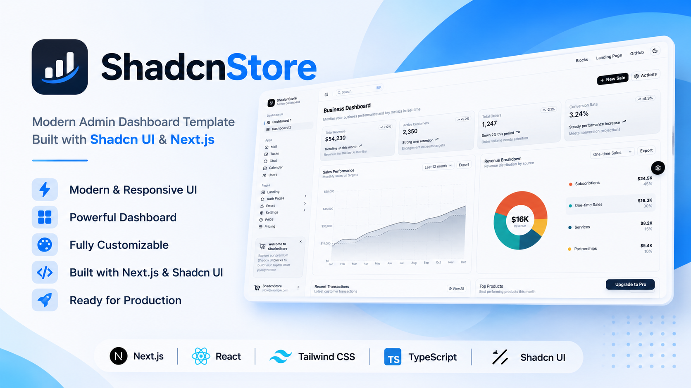

# Shadcn Dashboard & Landing Page Template

A modern, responsive dashboard and landing page template built with React, TypeScript, Tailwind CSS, and shadcn/ui.



## Features

- **Dashboard Layouts** – Two dashboard variations with analytics and business metrics.
- **30+ Pages** – Authentication, settings, pricing, errors, and application pages.
- **Application Interfaces** – Mail, tasks, chat, calendar, and user management.
- **Landing Page** – Complete marketing website with reusable sections.
- **Theme Customization** – Live theme editor with multiple color schemes.
- **Dark & Light Mode** – Built-in theme switching.
- **Responsive Design** – Layouts optimized for different screen sizes.
- **Data Visualization** – Charts, tables, sorting, filtering, and pagination.
- **Reusable Components** – Modular UI components built with shadcn/ui.

## Tech Stack

| Category | Technologies |
|---|---|
| Frameworks | React 19, Next.js 16 |
| Language | TypeScript |
| Build Tool | Vite 8 |
| Styling | Tailwind CSS v4 |
| UI Components | shadcn/ui, Base UI |
| Icons | Lucide React |
| State Management | Zustand |
| Forms & Validation | React Hook Form, Zod |
| Tables | TanStack Table |
| Charts | Recharts |

## Project Structure

```text
shadcn-dashboard-landing-template/
├── vite-version/
│   └── src/
│       ├── app/
│       │   ├── dashboard/
│       │   ├── dashboard-2/
│       │   ├── landing/
│       │   ├── auth/
│       │   ├── mail/
│       │   ├── tasks/
│       │   ├── chat/
│       │   ├── calendar/
│       │   ├── users/
│       │   ├── settings/
│       │   ├── errors/
│       │   ├── faqs/
│       │   └── pricing/
│       ├── components/
│       ├── hooks/
│       ├── lib/
│       └── types/
│
├── nextjs-version/
│   └── src/
│       ├── app/
│       ├── components/
│       ├── hooks/
│       ├── lib/
│       └── types/
│
├── docs/
│   └── landing.png
│
├── README.md
└── LICENSE
```

## Getting Started

### Requirements

- Node.js 20.19+
- pnpm (recommended) or npm

### Vite + React

```bash
cd vite-version

pnpm install

pnpm dev
```

### Next.js

```bash
cd nextjs-version

pnpm install

pnpm dev
```

## Development Commands

| Command | Description |
|---|---|
| `pnpm dev` | Start development server |
| `pnpm build` | Build for production |
| `pnpm preview` | Preview production build (Vite) |
| `pnpm start` | Start production server (Next.js) |
| `pnpm lint` | Run linting |

## License

This project is licensed under the MIT License.

You are free to use, modify, and distribute this template according to the license terms.

## Credits

Built with:

- React
- Next.js
- shadcn/ui
- Base UI
- Tailwind CSS
- Lucide
- Recharts
- TanStack Table

## License